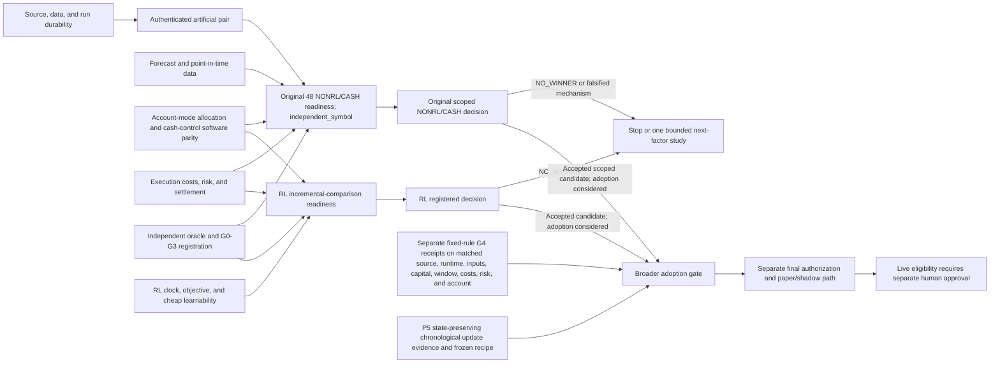

# Issue #810: long-term profitability program

**Status:** active implementation and evidence plan. This document organizes work; it does not authorize a fit, market replay, sealed or unused-data access, economic acceptance, or live order.

## Objective and invariants

Build and evaluate a systematic trader whose market analysis, trade features, teacher labels, runtime signal, policy, and order decisions do not use an LLM. A result counts toward the objective only when a frozen, reproducible candidate improves terminal net wealth after fees, spread, impact, funding, and execution delays against the same-capital cash and fixed-rule controls, under the registered risk and stress contract. Forecast accuracy, software completion, a green CI run, a lower drawdown alone, and a successful synthetic replay do not establish profitability.

Keep the existing capital, instrument and period scope, cost model, funding treatment, execution and risk semantics fixed for each registered comparison. `account_mode=independent_symbol` is the existing default. `shared_portfolio` is a distinct registered candidate using the same total-capital denominator; do not silently migrate the default to a global account. The research drawdown guardrail remains 20%. Keep selection and evaluation chronological. A period used to select a feature, threshold, model, candidate, or interpretation remains consumed; it does not become unused by renaming a run or branch. Require terminal settlement to flat with no pending order. Do not claim a winner until the controlled Study has accepted lineage and a result-blind registered selection rule returns WINNER.

The non-RL cash and simple-rule controls are the first economic reference. They do not block parallel RL interface work or small synthetic learnability diagnostics. RL software may advance after its own clock, context, source, and objective prerequisites are met. Costly RL training and parameter search require their own bounded G0-G3 evidence budget and preregistered comparison; a profitable NONRL result is not an eligibility prerequisite for that independent research question.

LLMs may support implementation and review. They are excluded from the trader's runtime signal, policy, and order decision path. No live capital or orders are authorized by this program. Any live order requires a separate explicit human approval after the paper/shadow and venue-readiness evidence is complete.

## Verified snapshot for this plan

The source baseline is PR #953 head `a9e99132d8168b685d21e0e9f49f66775149076e`, based on `9e8ba2e02c0fdccb1e7fe6d615af41cd6575881f`; GitHub `main` was `5f466f67634662d505bda96c460a1c82b1cfec09` when this plan was prepared. The primary local checkout was stale and dirty, so this plan was prepared in a dedicated worktree from the PR head. Recheck the live PR graph and exact main SHA before any implementation branch is integrated.

The durable [Issue #810 development checkpoint](https://github.com/shuntatsu/trade_rl/releases/tag/research%2Fissue810-development-checkpoint-20261015) and [current issue progress readback](https://github.com/shuntatsu/trade_rl/issues/810#issuecomment-6357712193) are the portable status references. The supplied 2026-10-23 metadata inventory has SHA-256 `7909fea19f8b0708bc6eae45ab5372c36afb0d894c9031a1fc80d6d5e434ea8c`; it records Dataset identity `e916…` and manifest identity `6ac509…`. A 48-role plan exists, but per-cell artifact bindings remain empty or unestablished and zero native arms are complete. Twelve configuration combinations are not twelve verified fitted artifacts. The original R2 protocol source `30c5…` does not by itself prove that H source `8bc2fd0c` was the actual frozen runtime source.

The artificial attempt `6b6e…` reached NONRL actor plus reserve progress and then partial CASH progress, with no global finalization. Its state is UNKNOWN/STOPPED, not a pass. Preserve it and the earlier incomplete attempt `41f7…` under their original identities. No full consumed-development 48-arm comparison, G4 economic result, final/unused-period evaluation, or live eligibility is established.

PR #951 head is `9e8ba2e02c0fdccb1e7fe6d615af41cd6575881f`, and root consolidation PR #945 is `9f40cc93aec8439a3740aec4e2aa2b842ad893a3` on base `5f466f67634662d505bda96c460a1c82b1cfec09`. PR #953 contributes a reviewed static source-declaration profile; refresh CI state at the exact head. This is not evidence of a fresh native H execution or a financial result. PR #952 had two failing test cases in one Lean Core job; local candidate `81a0379ef9ad17afde9daa590fb4601974998b12` had review approval but had not been applied to the PR head. PR #949 had a CI failure on a static-profile fixture and held local candidate `d5689f49b8fadd7d324c1ee6bbd03104b4f2653b`. Refresh each exact head, review, and check result before relying on this queue; stacked ancestry is not merge evidence.

The active issue status remains incomplete. Forecast preparation is partial; a fresh full matrix on the current candidate has not completed, and prior interrupted/failed attempts remain incomplete. No profitability, winner, final-data, or live claim follows from the software candidates.

## Parallel delivery model

The backlog contains 24 independently bounded cards across seven streams. Dependencies are evidence gates, not a calendar. Workers may implement separate source-owned components in parallel as soon as each card's entry conditions hold; integrated economic comparisons wait for the joined gates.

Card ownership uses one writer per source/resource lease. RACI is consistent across the cards: the program coordinator is Accountable for assignment, interface boundaries, and evidence reconciliation; the named card owner is Responsible for the listed files and exit packet; a fresh independent reviewer is Consulted on the exact resulting head; adjacent stream owners are Informed at handoff. The reviewer uses a different configured model/task from the implementation. If source overlap appears, split the card or serialize the shared files before writing.

The current capacity ceiling is the coordinator plus three active workers. Keep a flexible slot for independent review when an exact head is ready, and refill released capacity from the backlog. The 24 cards are not 24 simultaneous agents. No calendar completion date is implied. Current per-task model and review availability must be refreshed when each card is assigned.

At this snapshot, nonplanning implementation work is assigned to Luna Max. Exact-head formal review uses 6-sol High through 2026-10-24T00:57:33Z, then the authorized AGY route is preferred (Gem4 High; 3.8 High or Sonnet 5.5 as the stated fallbacks). Reconfirm availability and authorization before each review; model identity does not establish research approval.

Implementation branches use the repository's PR path. Each tested PR head must contain current `main`; required full CI must be green on that same head before integration. Do not update or combine frozen research refs or failed artifacts as a side effect of implementation. See root `AGENTS.md`, `docs/AGENTS.md`, and the research-assurance, controlled-experiment, and final-authorization contracts for the governing requirements.

### Immediate queue at the snapshot

| Queue | Current owner/state | Next evidence or handoff |
|---|---|---|
| W02 runner lifecycle / #952 | Active implementation follow-up; #952 had two failing test cases in one Lean Core job at the captured snapshot. Candidate `81a0379ef9ad17afde9daa590fb4601974998b12` has source review but is not yet the PR head. | Re-read exact PR head and checks; retain stopped-attempt evidence and repair only the identified runner contract. |
| W03 source-envelope measurement / #949 | Active implementation follow-up; local candidate `d5689f49b8fadd7d324c1ee6bbd03104b4f2653b` is held after a CI fixture failure. | Re-read exact PR head/checks, establish baseline measurements, then decide whether optimization is warranted. |
| This plan | Active documentation writer. | Finish source leases, dependency split, and evidence-gated cards; request an independent exact-head review when ready. |
| Next source-only cards | W04 point-in-time data/forecast audit and W10 RL financial-clock/context audit are independent lanes. W01 can perform read-only metadata reconciliation. | Refill released implementation slots from these cards; W05/W06 and W11/W12 follow their own evidence prerequisites. No lane needs positive NONRL P&L to begin its allowed software or synthetic work. |
| Independent review | Flexible reserved capacity, not a permanently assigned worker. | Use a fresh reviewer/task when a card or PR head is ready; refresh configured model availability at assignment. |

The current live PR/checkpoint state is tracked in the linked [Issue #810 progress readback](https://github.com/shuntatsu/trade_rl/issues/810#issuecomment-6357712193). Re-read source and exact-head CI before acting on this snapshot.

### Evidence milestones

These milestones organize decision evidence; they do not serialize independent code work. Each card's entry rules, owner lease, validation, falsifier, and resource cap remain controlling. M6 is a parallel branch: it can answer a separately preregistered RL question when its own prerequisites pass, regardless of NONRL P&L.

| Gate | Scope and exit evidence | Cards |
|---|---|---|
| M0 — Source and attempt integrity | Exact Dataset/manifest/source/runtime bindings, stopped-run recovery, measured validation cost, authenticated artificial comparison pair. Missing bindings stay UNAVAILABLE; technical completion is not an economic result. | W01-W03, W16, W19 |
| M1 — Causal data and cost scope | Point-in-time feature/label availability, forecast maturity, exact fees/funding/impact/latency assumptions, and source-pinned direct-simple units. | W04-W05, W13 |
| M2 — Forecast and control software parity | Calibrated forecast diagnostics stay separate from P&L; cash/fixed-rule interfaces preserve the registered account contract. Software parity is not fixed-rule economic evidence. | W06-W09 |
| M3 — NONRL feasibility | Original independent_symbol account, order path, and terminal handling pass capacity/stress and independent-ledger checks; separately registered shared_portfolio work is not an original-matrix prerequisite. G0-G3, lineage, and exact-source review remain required. | W07-W09, W13-W18 |
| M4 — Scoped development comparison | The original 48-role NONRL/CASH roster completes with immutable receipts and its original preregistered decision only; it has no fixed-rule arms. Incomplete cells remain INCOMPLETE and this plan does not authorize the run. Broader adoption needs separate fixed-rule G4 and P5 evidence. | W20-W21 |
| M5 — One mechanism-driven next factor | Only after a completed NO_WINNER decision, test one falsifiable mechanism under a fresh finite preregistration; otherwise retain cash as the active control. | W22 |
| M6 — RL incremental question | Clock, objective, parity, cheap learnability, P5 state-preserving updates, frozen controls, independent gates, and explicit fit/compute budget support a bounded direct or residual comparison. Positive NONRL P&L is not a prerequisite. | W10-W12, W17-W18, W23 |
| M7 — Final and operational readiness | A program-level WINNER requires matched fixed-rule G4 receipts and a passing P5 handover/update recipe before the distinct one-shot unused-window gate; paper/shadow uses that frozen recipe. Any live order remains a separate explicit human approval. | W24 |

## Work cards

Every card has its own source lease and exit evidence. Software checks establish implementation behavior only. Cards that open data or make economic claims need a separate G0-G3 approval and an immutable, bounded run protocol before execution.

Before adding a component, the owner inspects the current implementation and nearest contract tests, then repairs or extends the existing owner where possible. A second allocator, account/ledger, artifact reader, or runner needs a documented contract gap and independent review before it is proposed.

### Stream A — source, provenance, and run durability

**W01 — Reconcile the 48-arm source and artifact roster.**

- **Owner / lease:** one source-provenance worker; source and inventory review is read-only, with no source-file write lease. Other Tier D files are read-only inputs.
- **Entry:** exact candidate Dataset, manifest, protocol, H/Q source profiles, plan, and output identities are supplied. Keep R2 source `30c5…`, frozen H source `8bc2fd0c`, later H declaration profiles, and Q source identities separate; a declaration profile does not prove runtime use. No raw/model/forecast/result content is needed for this inventory.
- **Deliverable / exit evidence:** source-derived table binds each planned cell to configuration, symbol, scenario, role, Dataset and manifest, fit identity if present, and exact native/comparison source. Reconcile that table against the original immutable inventory.
- **Falsifier / decision:** any ambiguous source, missing fit, mismatched role, or plan-to-inventory gap leaves the affected cell UNAVAILABLE; do not infer reuse or rewrite its pin.
- **Cap:** metadata-only reads, zero fits, zero new market-data requests, zero order, no artifact mutation.

**W02 — Close runner durability and stopped-attempt recovery.**

- **Owner / lease:** one Tier D runner worker; repair the existing runner with a write lease for `tools/tier_d_nonrl/tier_d_supervisor.py`, `tools/tier_d_nonrl/tier_d_process_tree.py`, `tools/tier_d_nonrl/resume.py`, `tools/tier_d_nonrl/restore.py`, `tools/tier_d_nonrl/progress_io.py`, and `tools/tier_d_nonrl/tier_d_protocol.py`.
- **Entry:** exact current PR/source base and all failed-attempt identities are retained; the current #952 and its local candidate are read back before editing.
- **Deliverable / exit evidence:** bounded process ownership, stop/reap behavior, immutable receipt retention, strict resume reconciliation, and explicit FAILED/INVALID/INCOMPLETE outcomes survive Windows failure-injection tests in `tests/tools/tier_d_nonrl/`.
- **Falsifier / decision:** an orphaned owned process, overwritten receipt, swallowed corruption, or mismatched outcome blocks any market arm and keeps the attempt incomplete.
- **Cap:** synthetic fixtures and one bounded Windows process probe; no fit or market replay.

**W03 — Measure source-envelope validation cost before optimizing it.**

- **Owner / lease:** one source-envelope worker; write lease for `trade_rl/evaluation/rl_allocation/_source_envelope_digest.py`, `trade_rl/evaluation/rl_allocation/global_execution_context.py`, `tools/market_b4_oracle/output_index.py`, `tools/market_b4_oracle/receipt_stream.py`, `tools/market_b4_oracle/frozen_forecast_index.py`, `tools/tier_d_scaling/`, `tests/evaluation/test_allocation_source_envelope_digest_guard.py`, and `tests/evaluation/test_allocation_declared_source_digest_guard.py`. W10 treats `global_execution_context.py` as a read-only dependency.
- **Entry:** pin exact source and fixture bytes, record an unoptimized baseline, and keep the frozen 48-arm runtime source distinct from the artificial source profile.
- **Deliverable / exit evidence:** same-input before/after measurements for wall time, peak process-tree RSS, disk, and validation counts; digest and fail-closed behavior remain identical in `tests/tools/market_b4_oracle/` and `tests/tools/tier_d_nonrl/`.
- **Falsifier / decision:** no measured end-to-end improvement, any skipped validation, or any artifact/source identity change stops the optimization from entering a measured run path.
- **Cap:** proposed cap for a future authorized measurement: artificial inputs only, at most four predeclared profile cases and one repetition each, within the existing 10,800-second, 2 GiB RSS, and 4 GiB disk engineering ceilings. This proposal does not authorize a run or predict full-market runtime.

### Stream B — causal data and forecasts

**W04 — Audit point-in-time inputs and label maturity.**

- **Owner / lease:** one data-availability worker; `trade_rl/data/` Dataset source, identity and feature builders, and the forecast dataset adapter.
- **Entry:** immutable Dataset/manifest identities and the proposed decision cutoff, label horizon, symbol roster, and publication clock are fixed.
- **Deliverable / exit evidence:** a field-by-field availability map distinguishes event, publication, collection, decision, and execution times; prefix/suffix mutation and label-endpoint checks pass in the nearest data and forecast contract tests.
- **Falsifier / decision:** any feature whose historical availability cannot be established is excluded or makes the relevant hypothesis unavailable; no substitute from later timestamps.
- **Cap:** read-only current Dataset metadata and already-consumed development scope; zero external fetch and zero fit.

**W05 — Verify prequential forecast vintages and direct-simple units.**

- **Owner / lease:** one forecast worker; `trade_rl/strategies/forecasts/simple_prequential.py`, `prequential.py`, `ridge.py`, `simple_return.py`, and `simple_stream.py`.
- **Entry:** W04 identifies an admissible causal feature/label scope and the existing forecast protocol is pinned.
- **Deliverable / exit evidence:** each H24/H72 vintage uses only matured prefix labels; packet units, symbol balance, feature roster, model vintage, and digest round-trip are explicit in `tests/strategies/test_prequential_forecasts.py` and `test_ridge_forecast.py`.
- **Falsifier / decision:** future-suffix mutation changes a prior vintage, label publication crosses the cutoff, or log-return is silently treated as simple return; stop the producer from integration.
- **Cap:** software fixtures and one already-consumed development reconstruction only when its Tier D identity is verified; no new fit is authorized here.

**W06 — Establish forecast usefulness and calibration diagnostics.**

- **Owner / lease:** one diagnostics worker; `trade_rl/evaluation/forecast_diagnostics.py` and the simple-return forecast consumer.
- **Entry:** W05 has a source-pinned stream; scoring window, baseline forecast, metrics, and missing-data rules are fixed before results are opened.
- **Deliverable / exit evidence:** report forecast error, calibration, coverage, and maturity/latency assumptions separately from trading P&L; nearest diagnostics tests and artifact read-back pass.
- **Falsifier / decision:** calibration failure or no forecast value beyond the declared baseline stops use of the forecast for economic allocation; it does not invalidate independent allocation or RL software work.
- **Cap:** one frozen diagnostic recipe over the already-consumed scope; no feature search, refit sweep, or new data.

### Stream C — NONRL allocation and controls

**W07 — Bound account-mode allocation and after-cost decision semantics.**

- **Owner / lease:** one allocation worker; audit and extend the existing allocator under a write lease for trade_rl/evaluation/forecast_allocation.py and trade_rl/evaluation/allocation_decision.py; allocation_costs.py and the public strategy interface are read-only dependencies owned by W13. Do not create a parallel allocator if the existing interface can express the registered action.
- **Entry:** W04/W05 causal packet units and the registered capital, account-mode, risk, and execution contracts are available.
- **Deliverable / exit evidence:** preserve account_mode=independent_symbol, the existing default and the mode used by the original 48-arm matrix, including its per-account capital, financial-clock, and risk invariants. A separately preregistered shared_portfolio candidate may use the existing allocator to map forecast, book state, and fixed costs to a bounded joint action using the same total-capital denominator; verify each mode with independent action-choice and boundary checks.
- **Falsifier / decision:** any implementation silently changes the default account mode, merges independent-symbol capital, mismatches forecast uncertainty/cost units, or depends on a future row; reject that contract.
- **Cap:** the original 48-arm matrix remains independent_symbol. shared_portfolio needs a separate preregistration and evidence budget; it is not an implicit migration or a W20 prerequisite.

**W08 — Define software parity for cash and fixed-rule controls.**

- **Owner / lease:** one control-baseline worker; trade_rl/evaluation/allocation_cash_control.py, trade_rl/evaluation/allocation_nonrl_walk_forward.py, trade_rl/evaluation/allocation_comparison.py, and comparison evidence adapters in trade_rl/evaluation/.
- **Entry:** capital, decision clock, hold/close rules, costs, symbol roster, period scope, account mode, and execution path are specified for the candidate and each software control.
- **Deliverable / exit evidence:** tests show that cash and each registered fixed-rule interface can consume the same declared account and emit the same terminal/accounting schema. This establishes software parity only; it does not establish fixed-rule economic receipts, G4, or superiority. Broader program adoption requires a separate preregistered, source/runtime/input-bound fixed-rule G4 receipt under the same capital, window, cost, risk, and account contract; see W21.
- **Falsifier / decision:** a control interface receives different capital, data, fee, clock, or settlement treatment; software parity is INVALID until repaired. Missing economic control receipts leave broader fixed-rule comparison NOT ESTABLISHED.
- **Cap:** preserve existing controls and parameters; one declared software-parity recipe, no post-result control retuning or W20 fixed-rule arms.

**W09 — Close account-mode-specific risk and no-trade feasibility envelopes.**

- **Owner / lease:** one risk/allocation worker; trade_rl/evaluation/allocation_selection.py, trade_rl/evaluation/allocation_global_execution.py, trade_rl/risk/portfolio.py, and trade_rl/risk/pretrade.py.
- **Entry:** W07 and W08 pin the account-mode-specific capital, clock, control, and order contracts.
- **Deliverable / exit evidence:** for original independent_symbol comparisons, independently check each account's capital denominator, financial clock, risk limits, no-trade region, hard risk priority, and terminal-close constraints. Global exposure aggregation and shared cash reservation apply only to a separately registered shared_portfolio candidate, whose bounded joint actions need independent risk-oracle counterexamples.
- **Falsifier / decision:** a candidate violates its registered account-mode risk budget, the 20% research DD guardrail, or flat settlement; stop admission for that candidate.
- **Cap:** preserve existing registered exposure limits. Any shared-capital behavior is scoped to the separately preregistered shared_portfolio candidate; no risk-limit expansion or extra W20 arm.

### Stream D — RL clock, objective, and bounded learnability

**W10 — Align the RL financial clock and portfolio context.**

- **Owner / lease:** one RL-clock worker; write lease for `trade_rl/strategies/rl/allocation_settled_clock.py`, `trade_rl/evaluation/rl_allocation/settled_env.py`, and transition validation. `trade_rl/evaluation/rl_allocation/global_execution_context.py` is a read-only dependency owned by W03.
- **Entry:** exact decision/execution clocks, shared account, forecast context, and action availability are specified. W08 profitability is not a prerequisite.
- **Deliverable / exit evidence:** training, evaluation, and actor/reserve clocks observe the same registered financial state; save/load and transition-timing tests reject future data and duplicate actions.
- **Falsifier / decision:** actor timing differs from market replay or uses a feature after its decision cutoff; halt RL integration.
- **Cap:** synthetic clock fixtures only; no training run and no change to market behavior.

**W11 — Bind reward, terminal wealth, and zero-residual policy parity.**

- **Owner / lease:** one RL-objective worker; `trade_rl/strategies/rl/allocation_objective_receipt.py`, `trade_rl/strategies/rl/allocation_model.py`, `trade_rl/strategies/rl/allocation_artifact.py`, and objective contracts.
- **Entry:** W10 supplies the exact clock/context; W08 establishes software-level control parity only; economic controls require separately preregistered G4 receipts.
- **Deliverable / exit evidence:** reward and terminal objective encode after-cost portfolio wealth with registered risk/settlement treatment; an all-zero residual policy reproduces the fixed base actor and artifact round-trips unchanged.
- **Falsifier / decision:** reward ranking conflicts with net wealth, the residual changes the zero-residual action, or terminal costs are omitted; stop fit admission.
- **Cap:** deterministic tests only; zero real fits, no hyperparameter search.

**W12 — Run cheap synthetic learnability and delayed-credit diagnostics.**

- **Owner / lease:** one learnability worker; `trade_rl/evaluation/rl_allocation/scheduled_credit_diagnostics.py`, allocation training diagnostics, and the existing settled learnability oracles.
- **Entry:** W10/W11 clocks and objective are fixed and adversarial counterexamples are registered before the synthetic result is inspected.
- **Deliverable / exit evidence:** the declared learner can express a predesigned causal action, learn delayed credit under the exact clock, and retain capital/risk boundaries in small synthetic cases, with the existing settled learnability tests as the closest oracle.
- **Falsifier / decision:** the learner cannot beat its zero-residual control on the synthetic mechanism or only succeeds with forbidden information; defer costly RL training.
- **Cap:** one fixed synthetic schedule per declared clock case; no market data and no broad seed/parameter sweep.

### Stream E — execution economics, risk, and settlement

**W13 — Trace the fixed fee, spread, impact, funding, and latency model.**

- **Owner / lease:** one execution-economics worker; `trade_rl/evaluation/allocation_costs.py`, `trade_rl/simulation/diagnostics/funding.py`, `trade_rl/simulation/diagnostics/execution_stress.py`, and data execution-economics profiles.
- **Entry:** frozen plan and Dataset cost identities are read back; any missing venue input is labeled as an assumption.
- **Deliverable / exit evidence:** every cost term is traced from source through action sizing, receipt, and accounting; base/cost2/latency scenarios are reproducible and retain the registered values.
- **Falsifier / decision:** a fee/funding/impact component is missing, double counted, or changed after seeing returns; no economic comparison may proceed.
- **Cap:** read-only source reconciliation and synthetic cost fixtures; zero venue request and no recalibration from outcome data.

**W14 — Verify order intent, lifecycle, and capacity under stress.**

- **Owner / lease:** one order-execution worker; `trade_rl/simulation/execution.py`, `trade_rl/simulation/orders/`, `trade_rl/simulation/stateful/execution.py`, and `trade_rl/evaluation/allocation_terminal_execution.py`.
- **Entry:** W07 action semantics and W13 cost/execution profiles are fixed.
- **Deliverable / exit evidence:** pending orders, partial fills, cancellation, quantity/lot constraints, latency, and shared capacity reconcile to the exact intended account transitions in differential tests.
- **Falsifier / decision:** fill evidence cannot explain the order path, a pending order crosses terminal settlement, or capacity is double allocated; stop that execution profile.
- **Cap:** existing artificial cases and registered stress profiles; no live order or profile expansion.

**W15 — Close terminal account state with an independent ledger.**

- **Owner / lease:** one accounting-oracle worker; use and test the existing independent `ReferenceAccount` in `tools/market_b4_oracle/reference_ledger.py` and `binary64_account.py`; treat `trade_rl/simulation/accounting.py` as the system-under-check. Do not build a second account model.
- **Entry:** W13/W14 economics, order events, and terminal rule are pinned.
- **Deliverable / exit evidence:** an independently implemented account calculation agrees row by row on cash, position, fees, funding, liabilities, equity, and terminal settlement; retain minimal failing counterexamples.
- **Falsifier / decision:** unexplained ledger differences, unsettled liabilities, non-flat positions, or active orders invalidate the comparison.
- **Cap:** artificial differential fixtures and already-consumed development receipts only; no separate account model can be substituted after results.

### Stream F — independent assurance and evidence authority

**W16 — Authenticate the native source, process witness, and receipts.**

- **Owner / lease:** one attempt-authority worker; repair the existing consumer/witness with a write lease for `tools/market_b4_oracle/outer_witness.py` and `tools/market_b4_oracle/offline_replay_consumer.py`. W03 owns the index/stream files; this card treats them as read-only dependencies. Do not create a second artifact reader.
- **Entry:** exact H/Q profiles, executable, cwd/import root, arguments, fresh output roots, and supervisor contract are fixed.
- **Deliverable / exit evidence:** the root witness proves the launched and consumed source/inputs, both roles complete the exact roster, full streams reach EOF, and original receipts remain immutable.
- **Falsifier / decision:** missing role, swapped profile, unauthenticated producer/runtime, incomplete tail, or absent root finish witness is INCOMPLETE/INVALID and cannot qualify a cell.
- **Cap:** one matched artificial pair for admission; no real 48-arm launch.

**W17 — Preregister G0/G1 and the economic falsifiers.**

- **Owner / lease:** one result-blind research-design worker; write lease for `docs/research/current-status.md` and the study-specific preregistration. The assurance and Study architecture contracts are read-only authorities.
- **Entry:** questions are separated into forecast value, allocation value, execution economics, and RL incremental value; source/data limitations are stated.
- **Deliverable / exit evidence:** objective, mechanism, causal story, assumptions, known limits, counterfactuals, primary/guardrail metrics, consumed-data scope, finite factor/seeds/retries, and stop rules are frozen before result access.
- **Falsifier / decision:** an edge story cannot identify a cause or distinguish its null; mark that question NOT ESTABLISHED and do not open G4.
- **Cap:** one preregistration per distinct question; the initial next-factor wave is limited to one factor and at most three registered conditions including its control.

**W18 — Verify G2 invariants, one-way data use, and post-artifact lineage.**

- **Owner / lease:** one assurance worker independent of the implementation; write lease for `trade_rl/evaluation/experiments/workflow.py`, `trade_rl/evaluation/experiments/evidence.py`, and their nearest contract tests. Research-status and architecture documents are read-only inputs owned by W17.
- **Entry:** W17 is frozen and exact implementation contracts are identified.
- **Deliverable / exit evidence:** independent oracle/counterexample matrix covers causality, source availability, global capital, risk, accounting, execution capacity, terminal state, immutability, and Tier D/Tier U use; fresh post-artifact reconstruction matches.
- **Falsifier / decision:** source/test share an unchallenged oracle assumption, result bytes can be rewritten, or consumed scope is ambiguous; fail G2/G3 admission.
- **Cap:** no new market access; one exact implementation head and its registered contract.

**W19 — Complete the artificial component-pair readiness gate.**

- **Owner / lease:** one integration worker; write lease limited to the existing join operator/tests for `tools/market_b4_oracle/artificial_component.py` and its nearest contract tests. W01-W03/W16 are read-only dependencies; RL and account-ledger files are outside this card.
- **Entry:** W02/W03/W16 are reviewed on exact heads; old attempts remain unchanged.
- **Deliverable / exit evidence:** one root-observed NONRL/CASH `comparison_only` technical pair completes 6,527 actor plus 72 reserve advances per role, validates its declared fill/close checks, empties the owned process tree, and returns a root-consumed result. This pair does not consume the independent `ReferenceAccount` ledger and cannot establish full B4; W15 remains required for W20.
- **Falsifier / decision:** timeout, missing receipt, no process-tree closure, invalid ledger, or consumer rejection means STOPPED/INCOMPLETE; diagnosis must preserve the original bundle.
- **Cap:** exactly one fresh admission pair; artificial Dataset only. Any technical retry needs a separately recorded Tier D justification and fresh review.

### Stream G — economic integration and later operations

**W20 — Run the original controlled 48-arm NONRL/CASH development matrix.**

- **Owner / lease:** one economic-run coordinator with separate preparation, execution, and read-only review responsibilities; the original roster is 4 configurations × 2 symbols × 3 scenarios × 2 roles.
- **Entry:** W01, W04-W06, W08, W13-W19 (including W15 independent-ledger closure), plus only the W07/W09 checks that preserve the existing independent_symbol contract; exact current-source review, G0-G3 approval, current-main software closure, and final plan/data/cost pins all pass. shared_portfolio work and RL cards W10-W12 are not prerequisites. The selected versioned native source must include the signed lot count and effective lot size needed by positive-lot fills. W08 software parity is not an economic fixed-rule control. This card is not authorized by the roadmap.
- **Deliverable / exit evidence:** all 48 planned cells have immutable start/finish/status, source/runtime/input pins, strict receipt read-back, independent ledger agreement, and terminal-flat/no-pending checks; report only the preregistered NONRL-versus-CASH metrics and guardrails. The immutable roster contains no fixed-rule arms and cannot establish fixed-rule superiority.
- **Falsifier / decision:** any unattempted, incomplete, invalid, unbound, or inconsistent cell keeps the matrix incomplete. A failed run cannot be re-labeled as a profitable comparison.
- **Cap:** the original 48 cells once, with original configs, horizons, symbols, roles, and BASEL0/COST2L0/BASEL2 profiles; no unregistered fit, extra repetition, data extension, fixed-rule arm, or retry. Only exact Tier D technical retries may be proposed separately and may not overwrite the failed attempt.

**W21 — Report the original scoped decision and separately gate broader adoption.**

- **Owner / lease:** one W20 Study owner reports its original result with a result-blind reviewer. A separate owner may prepare a broader-adoption evidence packet using the existing trade_rl/evaluation/rl_allocation/continuation.py and continuous_walk_forward.py; candidate-specific policy artifacts remain with their registered owner. Source changes are outside this card.
- **Entry:** for stage 1, W20 is complete and its original preregistration, analysis, roster, and decision rule are read back exactly as frozen before outcomes. Do not add a fixed-rule comparator, P5 recipe, or new criterion to the original Study after seeing results. Stage 2 requires a separate preregistration and finite G0-G3/evidence budget before any additional fit, replay, or control-study execution.
- **Deliverable / exit evidence:** stage 1 reports only the W20 preregistered NONRL-versus-CASH decision and classifications the original Study permits; it makes no fixed-rule superiority or broader program-adoption claim. If that scope or its receipts cannot support a decision, report NOT ESTABLISHED, INVALID, or INCOMPLETE as appropriate. For stage 2 broader adoption, bind fixed-rule G4 control receipts to the exact source, runtime, inputs, and the same capital, window, costs, risk, and account mode, and provide P5 chronological updates that preserve continuous cash, positions, pending orders, peak-risk state, and execution state with a frozen update/deployment recipe. Missing either evidence set leaves broader adoption and fixed-rule superiority NOT ESTABLISHED.
- **Falsifier / decision:** post-result criteria, a mismatch in capital/window/cost/risk/account mode, or state reset/drift blocks the broader-adoption decision; preserve any valid stage-1 result separately. The original 48-arm Study is never reranked or expanded to fill a missing broader-adoption control.
- **Cap:** stage 1 is one analysis of the frozen original EvidenceSet. Stage 2 is not authorized here: any separate fixed-rule/P5 study needs its own preregistered scope, finite budget approval, and G0-G3 gates; no extra arms, retries, or data access are added to W20.

**W22 — Test one mechanism-driven follow-up when results justify it.**

- **Owner / lease:** one new-study owner on new immutable identities; source files must be disjoint from any concurrent owner.
- **Entry:** W21 is complete and the result-blind decision identifies one falsified or unresolved mechanism with a new causal reason to test.
- **Deliverable / exit evidence:** one factor, one control, at most three conditions total, chronological scope, bounded resource plan, explicit falsifiers, and fresh G0-G3 approval before execution.
- **Falsifier / decision:** no new causal mechanism, no finite budget, or reuse of a sealed/ambiguous scope; stop the line. A second factor requires a later separate decision.
- **Cap:** at most three conditions and one attempt each in the first follow-up wave; no broad grid or change to capital, costs, risk, or execution.

**W23 — Measure RL incremental value against registered controls.**

- **Owner / lease:** one RL research owner; distinct source lease for the RL protocol, training artifacts, and comparison contract under trade_rl/evaluation/rl_allocation/ and trade_rl/strategies/rl/. Existing P5 continuation/fold/admission code and its tests are read-only dependencies; W10 owns no P5 files.
- **Entry:** W10-W12 pass, G0-G3 specify an RL-specific question, W08 software parity is frozen, and an explicit compute/fit budget is approved. Any fixed-rule economic control used for a broader adoption claim needs its own source/runtime/input-bound G4 receipts under the same capital, window, costs, risk, and account mode; interface parity alone is insufficient. Freeze the chronological P5 fold/update recipe, fold count, policy roster, capacity cases, and uncertainty/trial method before outcome review. Positive NONRL P&L is not an entry condition.
- **Deliverable / exit evidence:** compare a preregistered RL formulation to its direct or zero-residual parity control and the same-capital NONRL/cash controls; residual and direct formulations both remain eligible through separate bounded comparisons. Include fixed seeds, objective, financial clock, after-cost terminal wealth, drawdown, stress, capacity sensitivity, uncertainty/trial accounting, and failed-fit accounting. P5 policy updates must preserve continuous cash, position, pending-order, peak-risk, and execution state across chronological folds; freeze the update/deployment recipe before any WINNER decision.
- **Falsifier / decision:** no incremental net wealth, unstable result across the registered seeds, inability to learn delayed credit, state reset/drift across a P5 handover, or risk/terminal violation closes this candidate as NO_WINNER/INVALID. Missing P5 or required economic-control receipts blocks broader WINNER classification.
- **Cap:** one formulation/recipe per comparison, at most three preregistered seeds, one training attempt per seed, no hyperparameter sweep. Direct and residual formulations require separate preregistrations/budgets. Increase a cap only through a fresh evidence-budget decision before outcomes are inspected.

**W24 — Complete separate final evaluation, paper/shadow, and live-readiness gates.**

- **Owner / lease:** separate final-test and paper-operations owners; `trade_rl/evaluation/final_test/` and `trade_rl/evaluation/paper/` each have distinct file leases and evidence roots.
- **Entry:** before a program-level development WINNER is frozen, its registered W21/W23 decision must be joined with source/runtime/input-bound fixed-rule G4 receipts on the same capital, window, costs, risk, and account mode, plus passing P5 state-preserving handover evidence and a pinned update/deployment recipe. A W20 scoped NONRL/CASH decision alone is insufficient. Final data needs the preregistered unused window and one-shot authorization; paper/shadow needs its own venue-data, cost, operations, monitoring, and recovery contract.
- **Deliverable / exit evidence:** final consumer uses only the authorized window once and applies the frozen recipe without tuning or replacing it from final outcomes. Paper/shadow records order-free decisions, venue cost/latency, capacity, monitoring, restart, reconciliation, and kill-switch evidence using the same declared state-handover contract. Report live eligibility as a separate decision.
- **Falsifier / decision:** changed winner, data overlap, unverified venue assumptions, missing recovery evidence, or any unauthorized order stops the path and preserves the attempt.
- **Cap:** one final evaluation authorization/consumption; paper/shadow has no live order and no real capital. Live order requires separate explicit human approval after all evidence is reviewed.

## Acceptance and stop rules

Parallel implementation may continue while an economic gate is blocked if it stays within its card's source and data boundaries. No integration claim can bridge a missing card, and no card can grant another card's authority.

The first economic decision point is the original 48-arm NONRL/CASH comparison under account_mode=independent_symbol. W20/W21 can decide only the original roster and preregistered rule; they cannot establish fixed-rule superiority or absorb new P5 criteria after outcomes. If that scoped rule yields NO_WINNER, preserve it and decide whether W22 has one falsifiable mechanism worth a new registered budget. If a scoped result is accepted but broader program adoption is considered, separately preregister matched fixed-rule G4 receipts and P5 state-preserving chronological updates before freezing a program WINNER. Missing receipts or P5 evidence leave broader adoption NOT ESTABLISHED; any control study requires its own finite budget and G0-G3 approval, with no added arms to W20. If the original result is invalid or incomplete, repair only the identified contract and retain the attempt. Do not change capital, costs, risk, period, or controls to create a winner.

RL remains an optional incremental candidate. Its software and synthetic clock/learnability work can proceed alongside NONRL work. Real training consumes a separately preregistered finite budget and is judged against the same controls and financial objective. Neither forecast improvement nor algorithm complexity earns adoption without after-cost portfolio evidence.

A profitable development candidate still needs a frozen WINNER Study before the separate final authorization path can open. A final-data result cannot be used to retune the candidate. Paper/shadow operational evidence and explicit human approval remain separate from that authorization.
